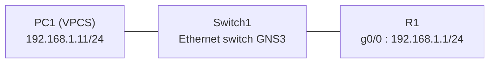
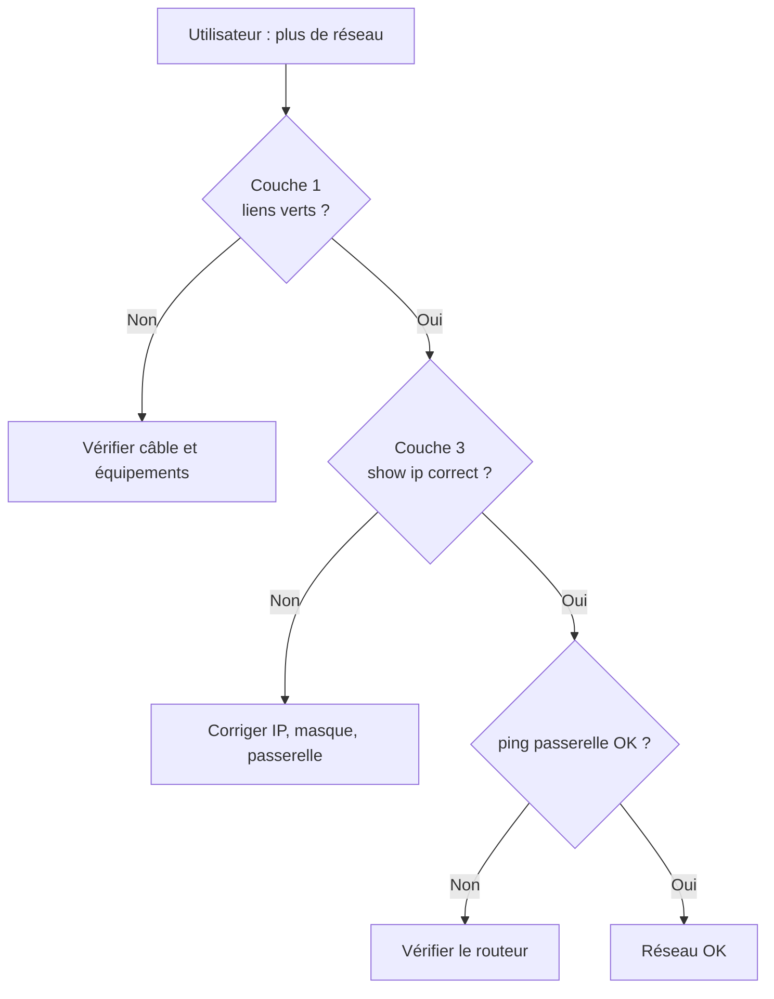

# Projet 4 – Diagnostic d'une panne réseau

> **Cours :** Networking Essentials – Infrastructure informatique et réseau d'une petite entreprise
> **Classe :** E1A  |  **Niveau :** Intermédiaire  |
  |  **Date :** 15 octobre 2026


---

## 1. Contexte

Un utilisateur signale qu'il n'accède plus au réseau.

Le formateur nous laisse carte blanche. Je dois donc :

1. Monter un petit réseau.
2. Simuler une panne moi-même.
3. La diagnostiquer avec la méthode en couches (modèle OSI).
4. La corriger.
5. Documenter l'intervention.

**Outil utilisé :** GNS3.

:::info
**Objectif :** montrer une démarche de diagnostic claire, preuves à l'appui.
:::

---

## 2. Topologie et plan d'adressage




| Équipement | Interface | Adresse IP | Masque | Passerelle |
|---|---|---|---|---|
| PC1 (VPCS) | e0 | 192.168.1.11 | 255.255.255.0 | 192.168.1.1 |
| R1 (routeur) | g0/0 | 192.168.1.1 | 255.255.255.0 | – |

:::warning
**Note sur les outils.** PC1 est un VPCS. Il n'a pas la commande `ipconfig`.
J'utilise l'équivalent : `show ip`. Pour `tracert`, j'utilise `trace`.
:::

---

## 3. État normal (avant la panne)

Preuves du réseau fonctionnel, avant toute panne.


---

## 4. La panne simulée

### Laquelle ?

**Une IP erronée sur PC1** : une faute de saisie sur une adresse statique.

| | Config correcte | Config avec la panne |
|---|---|---|
| IP | 192.168.1.11/24 | 192.168.2.11/24 |
| Passerelle | 192.168.1.1 | 192.168.2.1 |

Commande tapée sur PC1 :

```
ip 192.168.2.11 255.255.255.0 192.168.2.1
```


### Pourquoi cette panne ?

- **Réaliste.** C'est une erreur très courante sur un poste en IP statique.
- **Simple à reproduire.** Une seule commande suffit.
- **Bien adaptée au labo.** Mon réseau n'a qu'un seul sous-réseau. Une IP dans un autre réseau coupe la communication.
- **Riche pour le diagnostic.** Elle se voit avec `show ip`, `ping` et `trace`.

### Symptôme côté utilisateur

> « Je n'accède plus au réseau. »

---

## 5. Diagnostic couche par couche

### Méthode

On part du bas (couche 1) et on monte.
Le premier test qui échoue indique la couche en cause.



### Résultats

| Couche | Test | Résultat | Conclusion |
|---|---|---|---|
| 1 – Physique | Liens GNS3 verts | Liens verts | Câblage OK |
| 3 – IP (PC1) | `show ip` | IP 192.168.2.11/24, passerelle 192.168.2.1 | ❌ Hors du réseau 192.168.1.0/24 |
| 3 – Passerelle | `ping 192.168.1.1` | `host (192.168.2.1) not reachable` | ❌ Échec |
| 3 – Chemin | `trace 192.168.1.1` | `host (192.168.2.1) not reachable` | ❌ Échec |
| 3 – Routeur | `show ip interface brief` (sur R1) | g0/0 : 192.168.1.1, up / up | ✅ Routeur OK |


### Ce que ça nous apprend

- Le **câblage** et le **routeur** fonctionnent.
- Le problème vient donc de **PC1**.
- Son adresse est dans un autre réseau que celui du routeur.

---

## 6. Cause racine

:::danger
**PC1 est dans le réseau 192.168.2.0/24. R1 est dans le réseau 192.168.1.0/24.**
Deux réseaux différents ne communiquent pas sans routeur entre eux.
PC1 ne peut donc pas joindre sa passerelle.
:::

C'est une panne de **couche 3 (réseau)**, causée par une erreur de configuration.

---

## 7. Résolution

Sur PC1, on remet la bonne configuration et on la sauvegarde :

```
ip 192.168.1.11 255.255.255.0 192.168.1.1
save
```

VPCS a répondu :

```
Checking for duplicate address...
PC1 : 192.168.1.11 255.255.255.0 gateway 192.168.1.1
```

---

## 8. Validation

On refait les tests de diagnostic.


| Test | Avant correction | Après correction |
|---|---|---|
| `show ip` | 192.168.2.11/24 | 192.168.1.11/24 |
| `ping 192.168.1.1` |  not reachable |  5 réponses sur 5 |
| `trace 192.168.1.1` |  not reachable |  atteint 192.168.1.1 |

:::success
**Réseau rétabli.** PC1 communique de nouveau avec R1.
:::

:::info
**À propos du `trace`.** Le message `Destination port unreachable` est normal avec VPCS.
Il signifie que la destination (le routeur) a répondu. Le trajet est complet.
:::

---

## 9. Si la panne revient : marche à suivre

1. **Vérifier le physique.** Les liens sont-ils verts ?
2. **Lire la config du poste.** Sur PC1 :
   ```
   show ip
   ```
3. **Comparer avec le plan d'adressage** (section 2).
   - IP dans le bon réseau (192.168.1.x) ?
   - Masque 255.255.255.0 ?
   - Passerelle 192.168.1.1 ?
4. **Tester la passerelle.**
   ```
   ping 192.168.1.1
   ```
5. **Si l'IP est fausse, la corriger et sauvegarder.**
   ```
   ip 192.168.1.11 255.255.255.0 192.168.1.1
   save
   ```
6. **Valider** avec `show ip`, `ping` et `trace`.
7. **Si ça échoue encore**, vérifier le routeur avec `show ip interface brief`.

### Pour éviter que ça se reproduise

- Garder le **plan d'adressage** à jour et à portée de main.
- Relire l'IP saisie avant de valider.
- Faire un `show ip` après chaque changement.
- Envisager une attribution automatique des adresses (DHCP) pour limiter les saisies manuelles.

---

## 10.Explication des commandes

### Sur PC1 (VPCS)

| Commande | Rôle | Ce qu'on regarde |
|---|---|---|
| `ip <IP> <masque> <passerelle>` | Configure l'IP, le masque et la passerelle du poste | Un message d'erreur éventuel (`not same subnet`) |
| `show ip` (ou `sh ip`) | Affiche la config réseau du poste. Équivalent de `ipconfig` | IP/MASK, GATEWAY, MAC |
| `ping <adresse>` | Envoie des paquets de test et attend les réponses. Teste la connectivité | Réponses reçues, ou `not reachable` |
| `trace <adresse>` | Affiche le chemin vers la destination. Équivalent de `tracert` | Chaque saut, et la destination atteinte |
| `save` | Enregistre la config dans `startup.vpc` | Message `done` |

### Sur R1 (routeur Cisco)

| Commande | Rôle |
|---|---|
| `configure terminal` (`conf t`) | Entre en mode de configuration |
| `interface g0/0` | Sélectionne l'interface GigabitEthernet 0/0 |
| `ip address 192.168.1.1 255.255.255.0` | Donne l'adresse IP et le masque à l'interface |
| `no shutdown` (`no shut`) | Active l'interface |
| `exit` | Sort du mode en cours |
| `ip host <Nom-de-votre choix> 192.168.1.1` | Associe le nom `<Nom-de-votre-choix>` à l'adresse 192.168.1.1 |
| `end` | Revient directement au mode privilégié |
| `write memory` | Sauvegarde la config dans la NVRAM |
| `show ip interface brief` | Résume l'état et l'IP de chaque interface |

**Lire `show ip interface brief` :**

- **Status `up`** : l'interface est active.
- **Protocol `up`** : la liaison fonctionne.
- Pour `g0/0`, on attend `192.168.1.1`, `up`, `up`.

---

## 11. Limites

- **Le DNS n'a pas été testé.** L'image du routeur n'accepte pas `ip dns server`. Le routeur ne peut pas jouer le rôle de serveur DNS.
- **Le switch** est le switch Ethernet intégré de GNS3. Il n'a pas de ligne de commande.
- **Une seule panne** a été traitée : l'IP erronée.

---

## 12. Conclusion

- **Panne :** IP erronée sur PC1 (couche 3).
- **Méthode :** diagnostic de bas en haut, couche par couche.
- **Cause racine :** PC1 était dans le réseau 192.168.2.0/24, le routeur dans le 192.168.1.0/24.
- **Résolution :** reconfiguration de l'IP et de la passerelle de PC1.
- **Résultat :** réseau rétabli, tests validés par `show ip`, `ping` et `trace`.

La méthode en couches permet de localiser vite la panne. Elle évite de chercher au mauvais endroit.