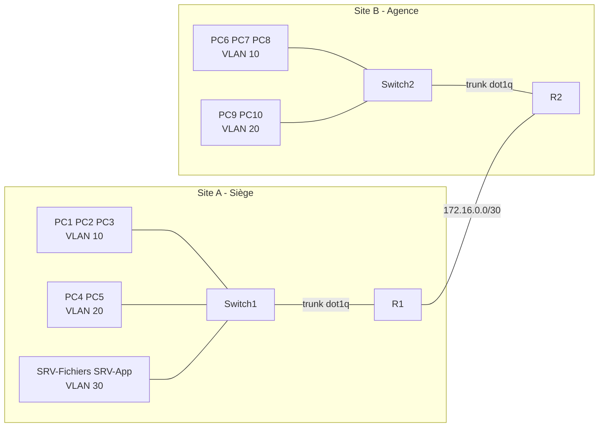

# Projet 5 : Conception réseau complète pour une PME multi-sites

**Cours :** Networking Essentials, Infrastructure informatique et réseau d'une petite entreprise
**Classe :** E1A
**Niveau :** Avancé
**Outil de simulation :** GNS3 (routeurs Cisco c7200, switchs Ethernet, VPCS)

---

## 1. Contexte et objectifs

Une PME possède **2 sites distants**. Ils doivent communiquer de façon sécurisée.

Objectifs du projet :

- Concevoir une architecture réseau multi-sites cohérente.
- Prévoir l'adressage IP, les VLAN et l'interconnexion des sites.
- Documenter les choix techniques et leurs justifications.

Livrables :

- Un schéma d'architecture réseau complet.
- Un plan d'adressage détaillé.

---

## 2. Recueil des besoins

L'énoncé ne donne aucune donnée chiffrée. J'ai donc fixé les besoins moi-même.
Ce sont des **hypothèses de conception**. Elles sont adaptées à une simulation : les effectifs sont volontairement réduits.

### 2.1 Sites et postes

| Site | Rôle | Postes (VPC) |
|---|---|---|
| Site A | Siège | 5 |
| Site B | Agence | 5 |

### 2.2 Répartition des postes

| Site | Employés | Comptabilité |
|---|---|---|
| Site A | 3 | 2 |
| Site B | 3 | 2 |

### 2.3 Services partagés

| Service | Hébergé sur | Accès depuis le site B |
|---|---|---|
| Serveur de fichiers (SRV-Fichiers) | Site A | Oui, via l'interconnexion |
| Serveur applicatif (SRV-App) | Site A | Oui, via l'interconnexion |

GNS3 n'a pas de serveur natif. Les deux serveurs sont donc **simulés par des VPC**. Ils ne font que répondre au ping.

### 2.4 Contraintes de sécurité

- Les employés n'accèdent pas au réseau de la comptabilité.
- Le trafic entre sites doit être sécurisé (voir les limites au point 9).
- Les serveurs sont isolés dans leur propre VLAN.

### 2.5 Croissance

Chaque sous-réseau laisse de la marge pour de futurs postes.

---

## 3. Plan d'adressage et VLAN

### 3.1 Règles retenues

- Plage privée : `10.0.0.0/8`.
- Format : `10.<site>.<VLAN>.0`.
- Site A : `10.1.0.0/16`. Site B : `10.2.0.0/16`.
- Lien entre sites : `172.16.0.0/30`.
- Passerelle de chaque VLAN : adresse `.1`.
- Adressage statique.

### 3.2 VLAN

| VLAN | Nom | Sites |
|---|---|---|
| 10 | Employés | A et B |
| 20 | Comptabilité | A et B |
| 30 | Serveurs | A seulement |

Le même numéro de VLAN sur les deux sites ne les relie pas. Ce sont deux réseaux distincts. Le routage les met en relation.

### 3.3 Sous-réseaux du site A

| VLAN | Réseau | Masque | Passerelle | Plage utilisable | Broadcast |
|---|---|---|---|---|---|
| 10 | 10.1.10.0/27 | 255.255.255.224 | 10.1.10.1 | .1 à .30 | 10.1.10.31 |
| 20 | 10.1.20.0/27 | 255.255.255.224 | 10.1.20.1 | .1 à .30 | 10.1.20.31 |
| 30 | 10.1.30.0/28 | 255.255.255.240 | 10.1.30.1 | .1 à .14 | 10.1.30.15 |

### 3.4 Sous-réseaux du site B

| VLAN | Réseau | Masque | Passerelle | Plage utilisable | Broadcast |
|---|---|---|---|---|---|
| 10 | 10.2.10.0/27 | 255.255.255.224 | 10.2.10.1 | .1 à .30 | 10.2.10.31 |
| 20 | 10.2.20.0/27 | 255.255.255.224 | 10.2.20.1 | .1 à .30 | 10.2.20.31 |

### 3.5 Lien inter-sites

| Équipement | Interface | Adresse |
|---|---|---|
| R1 | g1/0 | 172.16.0.1/30 |
| R2 | g1/0 | 172.16.0.2/30 |

### 3.6 Adresses des équipements

| Équipement | Site | VLAN | Adresse | Passerelle |
|---|---|---|---|---|
| PC1 | A | 10 | 10.1.10.2/27 | 10.1.10.1 |
| PC2 | A | 10 | 10.1.10.3/27 | 10.1.10.1 |
| PC3 | A | 10 | 10.1.10.4/27 | 10.1.10.1 |
| PC4 | A | 20 | 10.1.20.2/27 | 10.1.20.1 |
| PC5 | A | 20 | 10.1.20.3/27 | 10.1.20.1 |
| SRV-Fichiers | A | 30 | 10.1.30.2/28 | 10.1.30.1 |
| SRV-App | A | 30 | 10.1.30.3/28 | 10.1.30.1 |
| PC6 | B | 10 | 10.2.10.2/27 | 10.2.10.1 |
| PC7 | B | 10 | 10.2.10.3/27 | 10.2.10.1 |
| PC8 | B | 10 | 10.2.10.4/27 | 10.2.10.1 |
| PC9 | B | 20 | 10.2.20.2/27 | 10.2.20.1 |
| PC10 | B | 20 | 10.2.20.3/27 | 10.2.20.1 |

### 3.7 Justifications

- Un `/27` offre 30 adresses utilisables. C'est suffisant pour 5 postes avec de la marge.
- Un `/28` suffit pour les serveurs.
- Un `/30` convient au lien point à point. Il évite de gaspiller des adresses.
- Chaque site se résume en une seule route : `10.1.0.0/16` ou `10.2.0.0/16`.
- Le schéma `10.site.VLAN` facilite le dépannage. On lit le site et le VLAN dans l'adresse.

---

## 4. Choix de l'interconnexion

### 4.1 Solution retenue

Une **ligne dédiée simulée** entre R1 et R2. C'est un lien direct sur le réseau `172.16.0.0/30`.

### 4.2 Pourquoi ce choix

- L'énoncé l'autorise : « ligne dédiée simulée ».
- Elle est simple à mettre en place et à tester.
- Elle isole le trafic entre sites d'un réseau public.
- Elle permet de se concentrer sur l'adressage, les VLAN et le routage.

### 4.3 Alternative : VPN site-à-site

Un VPN site-à-site (IPsec) chiffrerait le trafic sur un réseau public. Il demande un routeur « Internet » entre R1 et R2, puis un tunnel. Je le garde comme amélioration (voir point 9).

### 4.4 Routage

Des **routes statiques** suffisent pour deux sites.

| Routeur | Destination | Via |
|---|---|---|
| R1 | 10.2.0.0/16 | 172.16.0.2 |
| R2 | 10.1.0.0/16 | 172.16.0.1 |

---

## 5. Schéma d'architecture

### 5.1 Schéma logique



### 5.2 Capture GNS3


### 5.3 Liens du site A

| De | Vers | Type |
|---|---|---|
| PC1, PC2, PC3 | Switch1 (ports 1, 2, 3) | Access VLAN 10 |
| PC4, PC5 | Switch1 (ports 4, 5) | Access VLAN 20 |
| SRV-Fichiers, SRV-App | Switch1 (ports 6, 7) | Access VLAN 30 |
| Switch1 (port 0) | R1 (g0/0) | Trunk dot1q |

### 5.4 Liens du site B

| De | Vers | Type |
|---|---|---|
| PC6, PC7, PC8 | Switch2 (ports 1, 2, 3) | Access VLAN 10 |
| PC9, PC10 | Switch2 (ports 4, 5) | Access VLAN 20 |
| Switch2 (port 0) | R2 (g0/0) | Trunk dot1q |

### 5.5 Lien entre sites

| De | Vers | Réseau |
|---|---|---|
| R1 (g1/0) | R2 (g1/0) | 172.16.0.0/30 |

---

## 6. Configuration

### 6.1 Switchs

Les switchs sont des « Ethernet switch » GNS3. Ils se configurent port par port.

**Switch1 (site A)**

| Port | Branché sur | Type | VLAN |
|---|---|---|---|
| 0 | R1 | dot1q | 1 (natif) |
| 1, 2, 3 | PC1, PC2, PC3 | access | 10 |
| 4, 5 | PC4, PC5 | access | 20 |
| 6, 7 | SRV-Fichiers, SRV-App | access | 30 |

**Switch2 (site B)**

| Port | Branché sur | Type | VLAN |
|---|---|---|---|
| 0 | R2 | dot1q | 1 (natif) |
| 1, 2, 3 | PC6, PC7, PC8 | access | 10 |
| 4, 5 | PC9, PC10 | access | 20 |


### 6.2 Routeur R1

Le routage inter-VLAN utilise une sous-interface par VLAN (« router on a stick »).

```
enable
configure terminal
hostname R1
interface g0/0
 no shutdown
 exit
interface g0/0.10
 encapsulation dot1Q 10
 ip address 10.1.10.1 255.255.255.224
 exit
interface g0/0.20
 encapsulation dot1Q 20
 ip address 10.1.20.1 255.255.255.224
 exit
interface g0/0.30
 encapsulation dot1Q 30
 ip address 10.1.30.1 255.255.255.240
 exit
interface g1/0
 ip address 172.16.0.1 255.255.255.252
 no shutdown
 exit
ip route 10.2.0.0 255.255.0.0 172.16.0.2
end
write memory
```


### 6.3 Routeur R2

```
enable
configure terminal
hostname R2
interface g0/0
 no shutdown
 exit
interface g0/0.10
 encapsulation dot1Q 10
 ip address 10.2.10.1 255.255.255.224
 exit
interface g0/0.20
 encapsulation dot1Q 20
 ip address 10.2.20.1 255.255.255.224
 exit
interface g1/0
 ip address 172.16.0.2 255.255.255.252
 no shutdown
 exit
ip route 10.1.0.0 255.255.0.0 172.16.0.1
end
write memory
```


### 6.4 Machines (VPC)

| VPC | Commande |
|---|---|
| PC1 | `ip 10.1.10.2/27 10.1.10.1` |
| PC2 | `ip 10.1.10.3/27 10.1.10.1` |
| PC3 | `ip 10.1.10.4/27 10.1.10.1` |
| PC4 | `ip 10.1.20.2/27 10.1.20.1` |
| PC5 | `ip 10.1.20.3/27 10.1.20.1` |
| SRV-Fichiers | `ip 10.1.30.2/28 10.1.30.1` |
| SRV-App | `ip 10.1.30.3/28 10.1.30.1` |
| PC6 | `ip 10.2.10.2/27 10.2.10.1` |
| PC7 | `ip 10.2.10.3/27 10.2.10.1` |
| PC8 | `ip 10.2.10.4/27 10.2.10.1` |
| PC9 | `ip 10.2.20.2/27 10.2.20.1` |
| PC10 | `ip 10.2.20.3/27 10.2.20.1` |

Chaque configuration est enregistrée avec `save`.


---

## 7. Sécurité : listes de contrôle d'accès (ACL)

### 7.1 Objectif

Par défaut, le routage inter-VLAN laisse tout passer. Il faut donc bloquer le trafic des **Employés (VLAN 10)** vers la **Comptabilité (VLAN 20)**, sur les deux sites.

### 7.2 Principe

- Une ACL étendue par routeur.
- Elle est posée en **entrée** sur la sous-interface du VLAN 10.
- Le trafic est bloqué avant de traverser le routeur.
- Le wildcard `0.0.0.31` correspond à un masque `/27`.

### 7.3 ACL sur R1

```
ip access-list extended BLOQUE-EMP-COMPTA
 deny ip 10.1.10.0 0.0.0.31 10.1.20.0 0.0.0.31
 deny ip 10.1.10.0 0.0.0.31 10.2.20.0 0.0.0.31
 permit ip any any
 exit
interface g0/0.10
 ip access-group BLOQUE-EMP-COMPTA in
```

### 7.4 ACL sur R2

```
ip access-list extended BLOQUE-EMP-COMPTA
 deny ip 10.2.10.0 0.0.0.31 10.2.20.0 0.0.0.31
 deny ip 10.2.10.0 0.0.0.31 10.1.20.0 0.0.0.31
 permit ip any any
 exit
interface g0/0.10
 ip access-group BLOQUE-EMP-COMPTA in
```

### 7.5 Incident rencontré

Pendant les tests, les pings Employés vers Comptabilité réussissaient encore sur R2. Le diagnostic a montré une **faute de nom** :

- L'ACL créée s'appelait `BLOQUE-EMP.COMPTA` (avec un point).
- L'interface appelait `BLOQUE-EMP-COMPTA` (avec un tiret).

L'interface pointait vers une ACL inexistante. Rien n'était bloqué.

**Correction :**

1. Recréation de l'ACL avec le bon nom.
2. Suppression de l'ancienne ACL.
3. Nouveau test : les pings sont bloqués.

**Leçon :** vérifier avec `show access-lists` et `show running-config` que le nom de l'ACL est identique sur l'interface.


---

## 8. Tests et résultats

### 8.1 Avant les ACL : connectivité complète

| Depuis | Vers | Rôle du test | Résultat |
|---|---|---|---|
| PC1 | 10.1.10.1 | Passerelle VLAN 10 | Réussi |
| PC1 | 10.1.10.3 | Même VLAN | Réussi |
| PC4 | 10.1.20.1 | Passerelle VLAN 20 | Réussi |
| PC4 | 10.1.20.3 | Même VLAN | Réussi |
| SRV-Fichiers | 10.1.30.1 | Passerelle VLAN 30 | Réussi |
| SRV-Fichiers | 10.1.30.3 | Même VLAN | Réussi |
| PC1 | 10.1.20.2 | Inter-VLAN | Réussi |
| PC1 | 10.1.30.2 | Inter-VLAN vers serveurs | Réussi |
| PC6 | 10.2.10.1 | Passerelle VLAN 10 | Réussi |
| PC6 | 10.2.10.3 | Même VLAN | Réussi |
| PC9 | 10.2.20.1 | Passerelle VLAN 20 | Réussi |
| PC9 | 10.2.20.3 | Même VLAN | Réussi |
| PC6 | 10.1.10.2 | Inter-sites | Réussi |
| PC6 | 10.1.30.2 | Site B vers SRV-Fichiers | Réussi |
| PC6 | 10.1.30.3 | Site B vers SRV-App | Réussi |
| PC9 | 10.1.20.2 | Comptabilité B vers A | Réussi |
| PC1 | 10.2.10.2 | Site A vers site B | Réussi |

Remarque : le premier ping d'un VPC peut échouer. Il sert à la résolution ARP. Le ping suivant réussit.

> 


> 


### 8.2 Après les ACL : blocages attendus

| Depuis | Vers | Résultat attendu | Résultat obtenu |
|---|---|---|---|
| PC1 | 10.1.20.2 | Bloqué | Bloqué |
| PC1 | 10.2.20.2 | Bloqué | Bloqué |
| PC6 | 10.2.20.2 | Bloqué | Bloqué |
| PC6 | 10.1.20.2 | Bloqué | Bloqué |

### 8.3 Après les ACL : accès autorisés

| Depuis | Vers | Résultat attendu | Résultat obtenu |
|---|---|---|---|
| PC4 | 10.1.20.3 | Réussi | Réussi |
| PC9 | 10.1.20.2 | Réussi | Réussi |
| PC1 | 10.1.30.2 | Réussi | Réussi |
| PC6 | 10.1.10.2 | Réussi | Réussi |


---


## 9. Limites et améliorations

### 9.1 Limites de la maquette

- **Le lien entre sites n'est pas chiffré.** C'est une ligne dédiée simulée. Le trafic circule en clair.
- Les serveurs sont des VPC. Ils ne fournissent aucun vrai service. Ils répondent seulement au ping.
- Les ACL filtrent tout le trafic IP entre Employés et Comptabilité. Elles ne distinguent pas les services.
- Les ports inutilisés des switchs restent en VLAN 1.
- Il n'y a aucune redondance : un seul routeur et un seul lien par site.
- Les routes sont statiques. Elles ne s'adaptent pas à une panne.

### 9.2 Améliorations possibles

- Remplacer la ligne dédiée par un **VPN site-à-site IPsec** sur un réseau « Internet » simulé.
- Désactiver les ports inutilisés et changer le VLAN natif.
- Ajouter un second lien entre sites et un protocole de routage dynamique.
- Remplacer les VPC par de vraies machines virtuelles pour les services.
- Ajouter un serveur DHCP et un serveur DNS.
- Affiner les ACL par service plutôt que par réseau complet.

---

## 10. Conclusion

L'architecture répond à l'énoncé :

- Deux sites sont reliés par un lien routé.
- L'adressage est cohérent et documenté.
- Les VLAN séparent Employés, Comptabilité et Serveurs.
- Des ACL protègent la comptabilité.
- Les tests valident la connectivité et le filtrage.

La principale limite est l'absence de chiffrement sur le lien inter-sites. Un VPN IPsec est la suite logique.