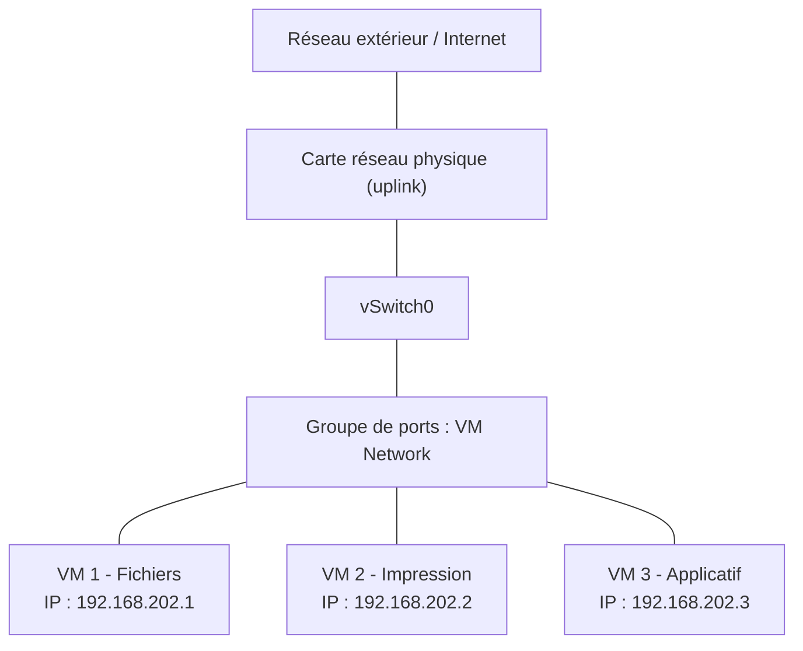

# PPE Projet 1 — Infrastructure virtuelle pour une PME

| | |
|---|---|
| **Cours** | Virtualisation — Mettre en place et exploiter une plateforme de virtualisation |
| **Niveau** | Débutant |
| **Durée** | 1 semaine (PPE) |
| **Hyperviseur** | VMware ESXi |

---

## 1. Contexte

Une PME de 15 salariés veut virtualiser 3 serveurs physiques :

- un serveur de fichiers ;
- un serveur d'impression ;
- un serveur applicatif.

L'objectif est de réduire les coûts matériels.

---

## 2. Limite rencontrée (à lire en premier)

> **Aucun poste physique n'était à disposition pour ce projet.**
> Dans cet environnement, la virtualisation ne permet pas le lancement des machines virtuelles.

Conséquence :

- Les **3 VM n'ont pas pu être démarrées** et validées.
- Les livrables « 3 VM opérationnelles » et « tests de fonctionnement » ne peuvent pas être fournis.
- Ce document décrit **ce qui a été réalisé** et **comment les VM auraient été créées**.

### Tentative faite pour Windows 11

L'installation de Windows 11 sur la VM 1 a été bloquée par les prérequis du système.
Un contournement par le registre (clé `LabConfig`) a été essayé. Il n'a pas fonctionné.

---

## 3. Ce qui a été réalisé

| Étape | État |
|---|---|
| Installation de l'hyperviseur ESXi | Fait |
| Ajout de disques à l'hôte | Fait |
| Création des banques de données VMFS 6 | Fait |
| Envoi de l'ISO dans la banque de données | Fait |
| Création de la VM 1 | Fait |
| Démarrage de l'installation de Windows 11 | Lancé, bloqué par les prérequis |
| Création des VM 2 et 3 | Fait|
| Validation des 3 VM | Non réalisé |

### Stockage

- 1 banques de données VMFS 6 a été créée : environ **100 Go**
- Choix retenu : **une seule banque de données** la VM, plus simple à gérer.

---

## 4. Architecture prévue

### Schéma réseau

---

---
- Un seul **vSwitch** relié à la carte physique.
- Un seul **groupe de ports** pour les 3 VM.
- Les VM communiquent entre elles et avec l'extérieur.
- Chaque VM a une **adresse IP fixe**.

### Ressources prévues

| VM | Rôle | vCPU | RAM | Disque (thin) |
|---|---|---|---|---|
| VM 1 | Fichiers | 2 | 1,5 Go | 25 Go |
| VM 2 | Impression | 1 | 1,5 Go | 25 Go |
| VM 3 | Applicatif | 2 | 1,5 Go | 25 Go |
| **Total** | | **5** | **4,5 Go** | **75 Go** |

Capacité de l'hôte : **8 vCPU** et **6 Go de RAM** (stockage ~100 Go pour les VM).

Justification :

- Le serveur de fichiers et le serveur applicatif demandent plus de CPU.
- Le serveur d'impression est le plus léger.
- Le total reste sous la capacité de l'hôte, avec une réserve pour ESXi.

> **Remarque :** Windows 11 recommande 4 Go de RAM. Pour une vraie PME, une édition **Windows Server (Server Core)** aurait été plus adaptée et plus légère.

---

## 5. Méthode : comment les VM auraient été créées

### Étape 1 — Préparer ESXi

1. Se connecter à l'interface web : `https://<IP-de-l-hôte>`.
2. Vérifier la banque de données dans **Stockage**.
3. Vérifier le `vSwitch0` et son uplink dans **Mise en réseau**.
4. Vérifier le groupe de ports `VM Network`.

### Étape 2 — Charger l'ISO

1. **Stockage > Explorateur de banque de données**.
2. Créer un dossier `ISO`.
3. Charger l'ISO du système.

### Étape 3 — Créer la VM 1 (Fichiers)

1. **Machines virtuelles > Créer/enregistrer une machine virtuelle**.
2. Nom : `<nom-VM1>`. Famille : Windows.
3. Banque de données : celle prévue.
4. CPU : 2. Mémoire : 1,5 Go. Disque : 25 Go en thin provisioning.
5. Réseau : `VM Network`.
6. CD/DVD : ISO du datastore, connecté à la mise sous tension.

### Étape 4 — Installer le système

1. Mettre la VM sous tension et ouvrir la console.
2. Installer le système sur le disque de 25 Go.
3. Définir le mot de passe administrateur.

### Étape 5 — Configurer le système

1. Renommer la machine : `<nom>`.
2. Configurer l'IP fixe : `<IP>`, `<masque>`, `<passerelle>`, `<DNS>`.
3. Activer le Bureau à distance.
4. Installer **VMware Tools**, puis redémarrer.

### Étape 6 — Installer le rôle de chaque VM

| VM | Rôle | Mise en place |
|---|---|---|
| VM 1 | Fichiers | Créer un dossier, puis le partager (partage SMB) |
| VM 2 | Impression | Activer le partage d'imprimante |
| VM 3 | Applicatif | `<application à préciser>` |

### Étape 7 — Créer les VM 2 et 3

Refaire les étapes 3 à 6 avec les ressources du tableau de la section 4.

### Étape 8 — Valider le fonctionnement

Sur chaque VM :

1. `ping` vers les 2 autres VM.
2. `ping` vers la passerelle.
3. `ping` vers une adresse externe.
4. `nslookup` sur un nom de domaine.

Puis :

- ouvrir le partage de la VM 1 depuis un autre poste ;
- vérifier que les 3 VM sont allumées dans ESXi.

---

## 6. Fiches de configuration par VM (modèle prévu)

### VM 1 — Fichiers

| Paramètre | Valeur |
|---|---|
| Nom | Fichier |
| Rôle | Serveur de fichiers |
| Système | Windows 11 |
| vCPU | 2 |
| RAM | 1,5 Go |
| Disque | 25 Go  |
| Réseau | VM Network |
| IP / masque | 192.168.202.1|
| Passerelle / DNS | 255.255.255.0 |

### VM 2 — Impression

| Paramètre | Valeur |
|---|---|
| Nom | Impression |
| Rôle | Serveur d'impression |
| Système | Windows 11|
| vCPU | 1 |
| RAM | 1,5 Go |
| Disque | 30 Go  |
| Réseau | VM Network |
| IP / masque | 192.168.202.2|
| Passerelle / DNS |255.255.255.0 |

### VM 3 — Applicatif

| Paramètre | Valeur |
|---|---|
| Nom | Application |
| Rôle | Serveur applicatif (`<application>`) |
| Système | Windows 11 |
| vCPU | 2 |
| RAM | 1,5 Go |
| Disque | 25 Go  |
| Réseau | VM Network |
| IP / masque | 192.168.202.3 |
| Passerelle / DNS | 255.255.255.0 |

---

## 7. Conclusion

- L'hyperviseur, le stockage et la VM 1 ont été mis en place.
- Faute de poste physique, la virtualisation n'a pas permis de démarrer les VM.
- Les 3 VM n'ont donc pas pu être validées.
- L'architecture, les ressources et la méthode sont documentées ci-dessus.
- Avec un poste physique, la procédure de la section 5 aurait été appliquée telle quelle.