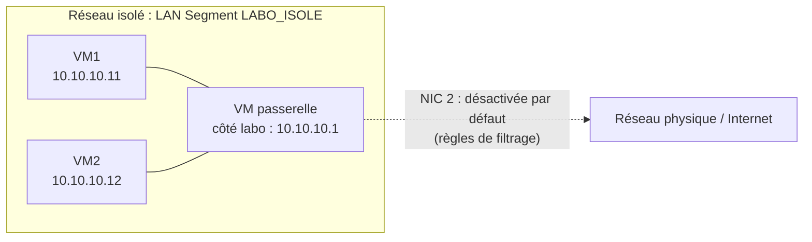

# Projet 3 — Réseau virtuel isolé (labo de test)

- **Cours :** Virtualisation — Mettre en place et exploiter une plateforme de virtualisation
- **Classe :** E1A
- **Niveau :** Intermédiaire
- **Durée :** 1 semaine (PPE)
- **Outil :** VMware Workstation
- **Système des VM :** Windows


---

## 1. Contexte et objectif

Un formateur veut un labo virtuel isolé du réseau. Les étudiants y testent des configurations risquées. Rien ne doit sortir du labo : ni vers Internet, ni vers le réseau physique.

---

## 2. Plan d'adressage

| Élément | Interface | Adresse IP | Masque |
|---|---|---|---|
| VM1 | `Ethernet0` | `10.10.10.11` | `255.255.255.0` |
| VM2 | `Ethernet0` | `10.10.10.12` | `255.255.255.0` |
| VM passerelle (côté labo) | `<interface_labo>` | `10.10.10.1` | `255.255.255.0` |
| VM passerelle (côté externe) | `<interface_ext>` | `<IP_GW_EXT>` (automatique) | automatique |

---

## 3. Schéma réseau

### Schéma annoté


### Légende des annotations

| N° | Annotation |
|---|---|
| ① | Réseau privé : aucune carte virtuelle sur le PC physique. |
| ② | Pas de DHCP, pas de NAT, pas de route par défaut sur les VM. |
| ③ | Ping entre VM autorisé par une règle de pare-feu. |
| ④ | Communication autorisée uniquement à l'intérieur du labo. |
| ⑤ | Accès contrôlé via la passerelle, si demandé seulement. |
| ⑥ | Aucun accès direct vers Internet ni le réseau physique. |

### Version texte (Mermaid)




---

## 4. Création du réseau isolé

### Choix retenu : LAN Segment

Un **LAN Segment** est un réseau privé entre VM. Il n'a pas de carte virtuelle sur l'hôte. Il n'a pas de DHCP ni de NAT. Il est donc isolé par conception.

### Étapes

1. Éteindre les VM.
2. Ouvrir **VM → Settings → Network Adapter**.
3. Cliquer sur **LAN Segments…** puis **Add**.
4. Nommer le segment : `LABO_ISOLE`.
5. Choisir **LAN Segment** et sélectionner `LABO_ISOLE`.
6. Répéter sur chaque VM du labo.


### Alternative : Host-only sans adaptateur hôte

1. **Edit → Virtual Network Editor → Change Settings** (droits admin).
2. **Add Network…** puis choisir un VMnet libre.
3. Type : **Host-only**.
4. **Décocher** « Connect a host virtual adapter to this network ».
5. **Décocher** « Use local DHCP service ».
6. Renseigner `10.10.10.0` et `255.255.255.0`.

Le décochage de l'adaptateur hôte coupe la liaison avec la machine physique.

---

## 5. Configuration IP des VM Windows (adresses statiques)

Il n'y a pas de DHCP sur un LAN Segment. On configure à la main.

### En PowerShell (administrateur)

```powershell
Get-NetAdapter
New-NetIPAddress -InterfaceAlias "Ethernet0" -IPAddress 10.10.10.11 -PrefixLength 24
ipconfig /all
```

| Commande | Explication |
|---|---|
| `Get-NetAdapter` | Liste les cartes réseau et leur nom (`InterfaceAlias`). |
| `New-NetIPAddress` | Définit une IP statique. Ne mets **pas** de passerelle pour l'instant. |
| `ipconfig /all` | Affiche toute la configuration IP. |

### En interface graphique (alternative)

`ncpa.cpl` → clic droit sur la carte → **Propriétés** → **IPv4** → **Utiliser l'adresse IP suivante**.


### Autoriser le ping (important)

Windows bloque le ping entrant par défaut. Sans cette règle, tes tests entre VM échoueront.

```powershell
New-NetFirewallRule -DisplayName "Labo - Ping entrant" -Protocol ICMPv4 -IcmpType 8 -Direction Inbound -Action Allow
```

| Élément | Explication |
|---|---|
| `New-NetFirewallRule` | Crée une règle du pare-feu Windows. |
| `-Protocol ICMPv4 -IcmpType 8` | Cible les requêtes d'écho (ping). |
| `-Direction Inbound` | Trafic entrant. |
| `-Action Allow` | Autorise. |

Vérifie aussi le profil réseau de la carte :

```powershell
Get-NetConnectionProfile
```

---

## 6. Tests de connectivité dans le labo

Depuis VM1 :

```powershell
ping 10.10.10.12
Test-NetConnection 10.10.10.12
```

Depuis VM2 :

```powershell
ping 10.10.10.11
```

| Commande | Explication |
|---|---|
| `ping <IP>` | Envoie des paquets ICMP. Une réponse prouve que la VM est joignable. |
| `Test-NetConnection <IP>` | Teste la connectivité et affiche un résumé (`PingSucceeded`). |


---


## 7. Preuve d'isolation

Ces tests doivent **échouer**. Fais-les depuis chaque VM du labo.

### 7.1 Pas d'accès Internet

```powershell
ping 8.8.8.8
nslookup google.com
Resolve-DnsName google.com
curl.exe -m 5 https://<site_web>
```


### 7.2 Pas d'accès au réseau physique

```powershell
ping 172.16.7.189
ping 172.16.0.1
```


### 7.3 Aucune route vers l'extérieur

```powershell
route print
Get-NetRoute -DestinationPrefix 0.0.0.0/0
tracert -d -h 3 8.8.8.8
```


| Commande | Explication |
|---|---|
| `ping 8.8.8.8` | Teste l'accès Internet par IP (sans DNS). |
| `nslookup <domaine>` | Teste la résolution DNS. |
| `Resolve-DnsName` | Équivalent PowerShell de `nslookup`. |
| `curl.exe -m 5 <url>` | Teste l'accès web. `-m 5` limite l'attente à 5 s. On écrit `curl.exe` pour éviter l'alias PowerShell. |
| `route print` | Affiche la table de routage. |
| `Get-NetRoute -DestinationPrefix 0.0.0.0/0` | Cherche une route par défaut. Il ne doit y en avoir aucune. |
| `tracert -d -h 3 <IP>` | Suit le chemin des paquets. `-d` sans DNS, `-h 3` limite à 3 sauts. |

### Tableau de preuves

| Test | Source | Cible | Résultat attendu | Résultat obtenu | Capture | 
|---|---|---|---|---|---|
| Ping | VM1 | VM2 | Succès | `Succès` |voir 6|
| Ping | VM2 | VM1 | Succès | `Succès` |voir 6|
| Ping | VM1 | 8.8.8.8 | Échec | `Echec` |voir 7.1|
| Ping | VM2 | 8.8.8.8 | Échec | `Echec` |voir 7.1|
| DNS | VM1 | `Google.com` | Échec | `Echec` |voir 7.1|
| Ping | VM1 | machine physique | Échec | `Echec` |voir 7.2|
| Ping | VM2 | machine physique | Échec | `Echec` |voir 7.2|


---

---

## 8. VM passerelle Windows avec filtrage

La passerelle est un clone de VM1 nommé `VM-Passerelle` (Windows 11). Elle a deux cartes réseau : une côté labo, une côté extérieur. Elle donne un accès contrôlé grâce au partage de connexion Internet (ICS). Le filtrage est fait par le pare-feu Windows de chaque VM du labo.

### 8.1 Création de la VM passerelle

1. Éteindre VM1 (le clone se fait VM éteinte).
2. Clic droit sur la VM → **Manage** → **Clone**.
3. Choisir **The current state**, puis **Create a full clone**.
4. Nommer le clone `VM-Passerelle`.
5. **VM → Settings** de `VM-Passerelle`.
6. Carte 1 : **LAN Segment** `LABO_ISOLE`.
7. **Add → Network Adapter**, puis choisir **NAT** pour la carte 2.


### 8.2 Configuration des cartes de la passerelle

```powershell
Get-NetAdapter
Rename-NetAdapter -Name "Ethernet0" -NewName "LABO"
Rename-NetAdapter -Name "Ethernet1" -NewName "EXTERNE"
Remove-NetIPAddress -IPAddress 10.10.10.11 -Confirm:$false
New-NetIPAddress -InterfaceAlias "LABO" -IPAddress 10.10.10.1 -PrefixLength 24
ipconfig /all
```

| Commande | Explication |
|---|---|
| `Get-NetAdapter` | Liste les cartes réseau et leurs noms. |
| `Rename-NetAdapter -Name ... -NewName ...` | Renomme une carte. `LABO` est côté labo, `EXTERNE` côté NAT. |
| `Remove-NetIPAddress -IPAddress ...` | Supprime l'ancienne IP héritée du clone. |
| `New-NetIPAddress -InterfaceAlias "LABO" ...` | Donne l'IP `10.10.10.1` à la carte labo. |
| `ipconfig /all` | Vérifie la configuration des deux cartes. |

Résultat obtenu :

| Carte | Adresse IP | Masque | Passerelle par défaut |
|---|---|---|---|
| `LABO` | `10.10.10.1` | `255.255.255.0` | aucune |
| `EXTERNE` | `192.168.202.134` (automatique) | `255.255.255.0` | `192.168.202.2` |


### 8.3 Activation du partage de connexion (ICS)

Par défaut, ICS impose une autre adresse à la carte labo. On lui indique `10.10.10.1` dans le registre.

```powershell
$p = "HKLM:\SYSTEM\CurrentControlSet\Services\SharedAccess\Parameters"
New-ItemProperty -Path $p -Name ScopeAddress -Value "10.10.10.1" -PropertyType String -Force
New-ItemProperty -Path $p -Name ScopeAddressBackup -Value "10.10.10.1" -PropertyType String -Force
Get-ItemProperty $p | Select-Object ScopeAddress, ScopeAddressBackup
Restart-Service SharedAccess
```

| Commande | Explication |
|---|---|
| `$p = "HKLM:\...\SharedAccess\Parameters"` | Stocke le chemin de la clé de registre d'ICS. |
| `New-ItemProperty -Name ScopeAddress ...` | Définit l'adresse que prendra la carte partagée. |
| `New-ItemProperty -Name ScopeAddressBackup ...` | Définit la même adresse pour la sauvegarde. |
| `Get-ItemProperty $p \| Select-Object ...` | Vérifie les valeurs enregistrées. |
| `Restart-Service SharedAccess` | Relance le service ICS pour qu'il relise la clé. |

Attention : l'adresse doit s'écrire avec un seul point entre chaque nombre. Avec `10.10.10..1`, la clé est ignorée et Windows choisit une autre adresse.

Activer le partage :

1. `ncpa.cpl`.
2. Clic droit sur **EXTERNE** → **Propriétés** → onglet **Partage**.
3. Cocher « Autoriser d'autres utilisateurs du réseau à se connecter… ».
4. Cliquer sur **OK**.

Il n'y a pas de liste à choisir : `LABO` est la seule autre carte. Vérifier ensuite avec `ipconfig` : la carte `LABO` doit garder `10.10.10.1`.


### 8.4 Accès via la passerelle depuis VM1

Sur VM1 (PowerShell administrateur) :

```powershell
New-NetRoute -DestinationPrefix 0.0.0.0/0 -InterfaceAlias "Ethernet0" -NextHop 10.10.10.1
Set-DnsClientServerAddress -InterfaceAlias "Ethernet0" -ServerAddresses 10.10.10.1
```

| Commande | Explication |
|---|---|
| `New-NetRoute -DestinationPrefix 0.0.0.0/0 -NextHop 10.10.10.1` | Ajoute la route par défaut vers la passerelle. |
| `Set-DnsClientServerAddress -ServerAddresses 10.10.10.1` | La passerelle devient le serveur DNS de la VM. |

Tests :

```powershell
ping 10.10.10.1
ping 8.8.8.8
nslookup google.com
curl.exe -m 5 https://google.com
```

Résultat : les quatre tests réussissent. Le serveur DNS affiché par `nslookup` est `10.10.10.1`.


### 8.5 Filtrage par le pare-feu Windows sur VM1

Sans filtre, la VM sort sans limite. On autorise seulement le labo et le web.

```powershell
New-NetFirewallRule -DisplayName "Labo - Sortie labo" -Direction Outbound -RemoteAddress 10.10.10.0/24 -Action Allow
New-NetFirewallRule -DisplayName "Labo - Web" -Direction Outbound -Protocol TCP -RemotePort 80,443 -Action Allow
Set-NetFirewallProfile -Profile Domain,Private,Public -DefaultOutboundAction Block
```

| Commande | Explication |
|---|---|
| `New-NetFirewallRule -DisplayName "Labo - Sortie labo" -RemoteAddress 10.10.10.0/24` | Autorise le trafic sortant vers le réseau du labo (passerelle et DNS compris). |
| `New-NetFirewallRule -DisplayName "Labo - Web" -Protocol TCP -RemotePort 80,443` | Autorise le trafic sortant vers les ports web (HTTP, HTTPS). |
| `-Direction Outbound` | Règle sur le trafic sortant. |
| `-Action Allow` | Autorise le trafic. |
| `Set-NetFirewallProfile -DefaultOutboundAction Block` | Bloque par défaut tout le trafic sortant non autorisé. |

Tests :

```powershell
curl.exe -m 5 https://google.com
ping 8.8.8.8
```

Résultat :

| Test | Résultat attendu | Résultat obtenu |
|---|---|---|
| `curl.exe -m 5 https://google.com` | Succès (port 443 autorisé) | Succès |
| `ping 8.8.8.8` | Échec (ping non autorisé vers l'extérieur) | Échec : « Défaillance générale », 4 paquets perdus |


### 8.6 Retour à l'isolation

Pour couper l'accès extérieur, on retire la route sur VM1 et on déconnecte la carte NAT de la passerelle.

```powershell
Remove-NetRoute -DestinationPrefix 0.0.0.0/0 -InterfaceAlias "Ethernet0" -Confirm:$false
Set-DnsClientServerAddress -InterfaceAlias "Ethernet0" -ResetServerAddresses
```

| Commande | Explication |
|---|---|
| `Remove-NetRoute -DestinationPrefix 0.0.0.0/0` | Supprime la route par défaut. |
| `Set-DnsClientServerAddress -ResetServerAddresses` | Efface le serveur DNS configuré. |

Dans VMware, ouvrir **VM → Settings → Network Adapter 2** de `VM-Passerelle` et décocher **Connected**.


---

---

## 9. Règles d'isolation appliquées

| N° | Règle | Mise en œuvre |
|---|---|---|
| 1 | Réseau privé sans lien avec l'hôte | LAN Segment `LABO_ISOLE` |
| 2 | Pas de DHCP ni de NAT sur le labo | Adresses statiques |
| 3 | Aucune route par défaut sur les VM (sans passerelle) | `route print` vérifié |
| 4 | Passerelle déconnectée par défaut | NIC 2 déconnectée |
| 5 | Sortie bloquée par défaut sur chaque VM | `DefaultOutboundAction Block` |
| 6 | Seuls les flux nécessaires sont autorisés | Règles ciblées (pare-feu, filtres RRAS) |
| 7 | Isolation vérifiée par des tests | Section 7 |

---

## 10. Checklist des livrables

- [x] Réseau virtuel isolé fonctionnel
- [x] Schéma réseau annoté
- [x] Preuves d'isolation (captures des tests)
- [x] Règles de filtrage documentées
- [x] Règles d'isolation listées

---
